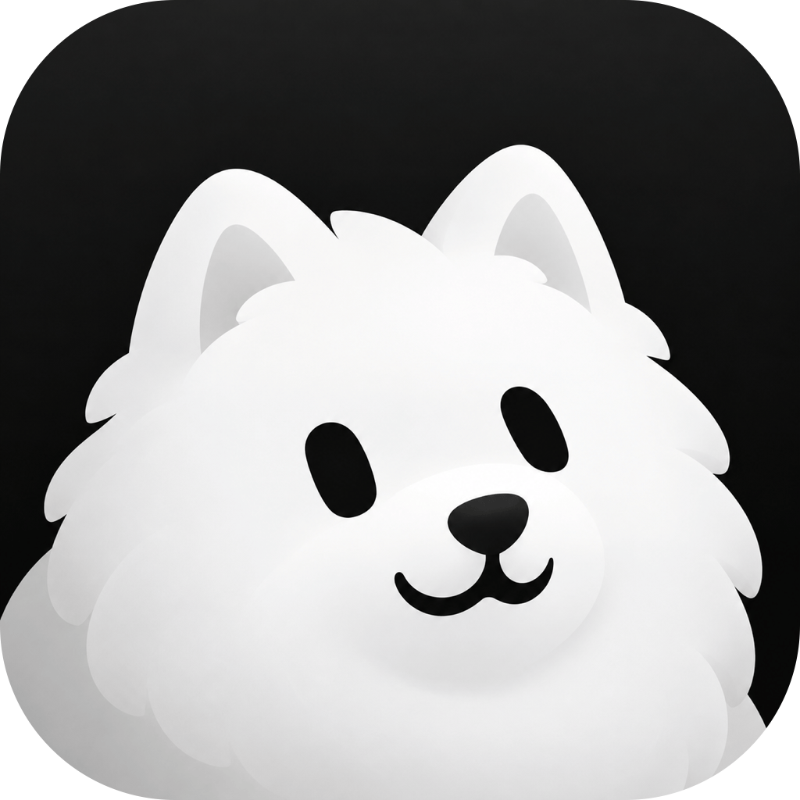
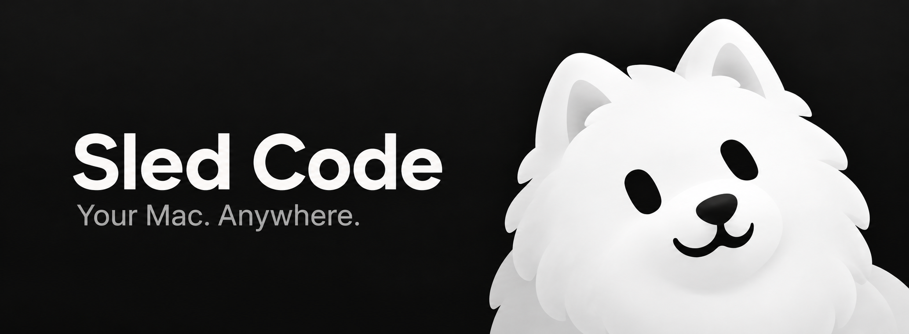

<p align="center">
  
</p>

<h1 align="center">Sled Code</h1>

<p align="center">
  <strong>Your development workspace, wherever you are.</strong><br />
  AI coding sessions and native remote desktop, together on your Mac and iPhone.
</p>

<p align="center">
  <a href="https://github.com/SamoyedLabs/sled-code/actions/workflows/ci.yml"></a>
  
  
</p>

<p align="center">
  <a href="#what-you-can-do">Features</a> ·
  <a href="#platform-support">Platforms</a> ·
  <a href="#build-sled">Build from source</a> ·
  <a href="#keeping-up-with-t3-code">Upstream updates</a> ·
  <a href="docs/operations/sled-maintenance.md">Maintainer guide</a>
</p>

<p align="center">
  
</p>

Sled Code builds on [T3 Code](https://github.com/pingdotgg/t3code), bringing its coding agents and development sessions together with native graphical access to your Mac. Open your workspace on your phone, move between agent sessions and the desktop, and interact with the applications running on your development machine.

> [!IMPORTANT]
> **macOS and iOS are the focus.** Most Sled-specific development and testing happens on these platforms. Remote desktop hosting currently works **only on Macs**, with a native **iOS client**. Android development and streaming are **not currently planned**; we may explore them in the future.

## What you can do

- **Keep your coding sessions close.** Continue using T3's agents, projects, terminals, and development sessions.
- **Reach the actual desktop.** Interact with Mac applications, IDEs, browsers, terminals, and simulators from the iOS app.
- **Use a native streaming pipeline.** ScreenCaptureKit capture, hardware video encoding, and native iOS decoding and rendering keep video out of the JavaScript bridge.
- **Connect directly, with a fallback.** WebRTC prefers a direct connection and supports relay fallback when needed, with paired and encrypted sessions.
- **Bring the useful desktop features along.** Remote input, clipboard sharing, audio, window streaming, and virtual displays are integrated into the remote desktop experience.
- **Choose when your Mac is available.** Tie the host to Sled's lifetime, or enable persistent hosting to keep access available after the desktop app quits.

## Platform support

| Platform                | Current focus                                                                        | Remote desktop                                                               |
| ----------------------- | ------------------------------------------------------------------------------------ | ---------------------------------------------------------------------------- |
| **macOS**               | Primary desktop development and testing                                              | **Host supported** — capture, encoding, remote input, and background hosting |
| **iOS**                 | Primary mobile development and testing                                               | **Native client supported** — view and control a connected Mac               |
| **Android**             | Upstream source retained; no active Sled development plan                            | **Unsupported** — the Swift client modules do not run on Android             |
| **Windows, Linux, web** | Upstream T3 surfaces remain in the codebase; outside Sled's current validation focus | No Windows/Linux host or web streaming client implementation                 |

The streaming integration uses Swift on macOS and iOS. Android streaming would need a separate native client integration. Broader platform support may be considered later, as the Mac and iOS experience develops; there is no committed timeline.

## Build Sled

Sled is currently developed and distributed as a **private beta**. The source is public; the iOS beta uses TestFlight. Build and signing instructions are for your own development environment.

### Run the development workspace

Use the Node and pnpm versions specified in [`package.json`](package.json).

```sh
git clone https://github.com/SamoyedLabs/sled-code.git
cd sled-code
pnpm install --frozen-lockfile
pnpm dev
```

### Build the Mac streaming host and desktop app

Native streaming builds require **Xcode 26 or newer**, its command-line tools, and CocoaPods. CI selects Xcode 26.3; the host deployment target is **macOS 14**.

```sh
python3 scripts/sled/prepare-native.py
python3 scripts/build-desktop.py
```

The preparation step verifies and installs the pinned native dependencies. The desktop build bundles the Mac host into the app. Application source is tracked directly in this repository.

### Build the iOS beta

The installed iPhone app is **Sled**, using bundle ID `com.samoyedlabs.sled`.

```sh
python3 scripts/sled/prepare-native.py
python3 scripts/testflight-ios.py archive --team <YOUR_TEAM_ID> --prepare
```

Archive, export, and upload are separate actions. Apple signing and App Store Connect access must be configured for your own team; the existing beta's app record belongs to its maintainer. For another team, also pass `--bundle-id` with an identifier registered to that team. Expo OTA updates default off and require a Sled-owned project to enable.

See the [maintainer guide](docs/operations/sled-maintenance.md) for signing, service configuration, releases, and the current hosted-auth dependency. Upstream development guidance remains in [the mobile guide](apps/mobile/README.md), [AGENTS.md](AGENTS.md), and [T3's original README](README.upstream.md).

## Keeping up with T3 Code

Sled Code is an independent repository that preserves T3's Git history. A scheduled workflow checks published T3 nightlies **every six hours** and prepares upstream updates against Sled's source.

```text
T3 nightly → Sled integration → automated checks → eligible merge
                         └──→ staged when review is needed
```

Candidates must pass checks on the exact commit before automatic promotion. Unresolved conflicts and changes requiring review remain staged. Automated checks and simulator testing are the default; physical phone testing is reserved for specific concerns automation cannot resolve, or an issue reported by the maintainer.

The native dependencies are pinned independently in [`sources.lock.json`](sources.lock.json). Details live in the [maintenance policy](docs/operations/sled-maintenance.md).

## Built on good foundations

- **[T3 Code](https://github.com/pingdotgg/t3code)** — the agent and remote development foundation. Its MIT license and copyright are retained in [`LICENSE`](LICENSE).
- **[Sill](https://github.com/Saffsanity/sill)** — native Mac hosting and iOS streaming components. Its Apache-2.0 license and modification notices are retained with the [host](native/remote-desktop/LICENSE) and [mobile module](apps/mobile/modules/t3-remote-desktop/Vendor/LICENSE).
- **[WebRTC](https://webrtc.org/)** — connectivity and transport, with [dependency notices and provenance](third-party/webrtc/manifest.json) preserved alongside the native components.

<p align="center"><sub>Built by Samoyed Labs · Focused on Mac and iOS</sub></p>
